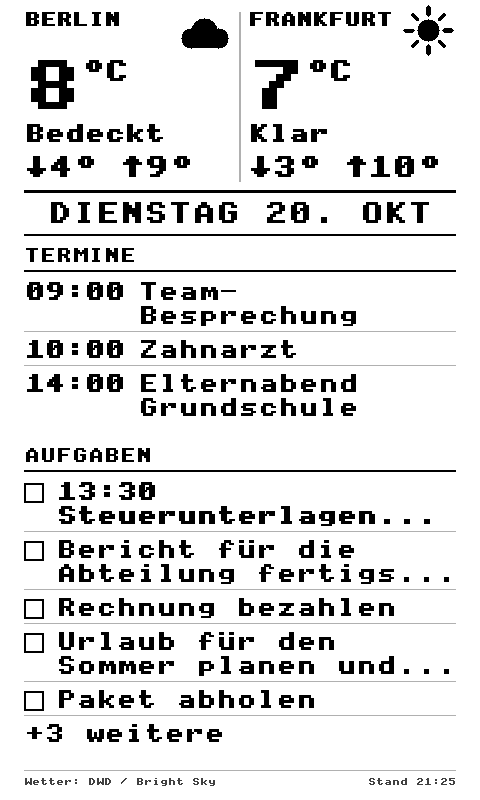

[English](README.md) · [Deutsch](README.de.md) · [Français](README.fr.md) · **Español**

# Worker para la pantalla de reposo con calendario de CrossPoint (XTEINK X4 / X4 Pro)

Un Cloudflare Worker que genera una vista del día como **BMP en escala de grises de 480x800**: el tiempo de
**dos lugares** (por defecto Berlín y Fráncfort del Meno), los **eventos de hoy** de Google Calendar y las
**tareas de hoy** de Todoist. La imagen está pensada como pantalla de reposo de la Xteink X4 / X4 Pro.

<p align="center">
  
</p>

> Proyecto personal no oficial. Se basa en
> [ckorhonen/crosspoint-calendar](https://github.com/ckorhonen/crosspoint-calendar) y usa datos meteorológicos del
> Servicio Meteorológico Alemán (DWD) y de Open-Meteo. Detalles, fuentes y licencias: [NOTICE.md](NOTICE.md).

**Dos partes que van juntas:**
- ☁️ **Servidor de imagen** (este repositorio): [worker-for-crosspoint-calendar-task-screen](https://github.com/RockyBalboa360/worker-for-crosspoint-calendar-task-screen)
- 🧩 **Firmware** del dispositivo: [crosspoint-calendar-task-screen](https://github.com/RockyBalboa360/crosspoint-calendar-task-screen/tree/feature/calendar-sleep-screen), **última versión: [Releases](https://github.com/RockyBalboa360/crosspoint-calendar-task-screen/releases/latest)**

## Funciones
- Tiempo: **Bright Sky** (datos del Servicio Meteorológico Alemán, medición de la estación más cercana) con
  **Open-Meteo** como respaldo automático; opcionalmente Visual Crossing como tercer respaldo.
- Google Calendar mediante una **cuenta de servicio** (también para calendarios privados); alternativamente una
  clave de API para calendarios públicos. Varios ID de calendario separados por comas.
- Eventos: solo **hoy**, los eventos terminados desaparecen. Si no queda ninguno, la sección indica
  «Keine weiteren Termine» («No hay más eventos»).
- Tareas de Todoist (filtro ajustable, por defecto `today | overdue`): hasta **8**, tantas como quepan; el resto aparece
  como «+N weitere» («+N más»). Cada entrada puede ocupar dos líneas.
- **Elección del reparto del espacio:** todos los eventos, un número fijo de eventos, un número fijo de tareas o todas
  las tareas (véase más abajo).
- Las palabras largas se dividen por sílabas («Urlaubs-tage») para llenar las líneas. Las reglas son simplificadas y no
  usan diccionario, por lo que alguna división puede no ser del todo correcta.
- La propia imagen está en alemán (diéresis, letra grande, salto de línea en títulos largos).
- La línea inferior dice «Stand: 24. Oktober '26, 20:34 CEST» (CET en invierno).

## Puesta en marcha
1. **Google:** activa la API de Calendar en tu proyecto de Google Cloud, crea una cuenta de servicio, genera una clave
   JSON y comparte tu calendario con la dirección de correo de la cuenta de servicio en Google Calendar («Ver todos los
   detalles de los eventos»).
2. **Todoist:** copia el token de API desde *Ajustes → Integraciones → Desarrollador*.
3. **Desplegar el worker** (requiere Node.js):
   ```bash
   npx wrangler deploy
   npx wrangler secret put GOOGLE_SERVICE_ACCOUNT_EMAIL   # client_email del archivo JSON
   npx wrangler secret put GOOGLE_PRIVATE_KEY             # private_key del archivo JSON
   npx wrangler secret put GOOGLE_CALENDAR_ID             # p. ej. tu dirección de Gmail
   npx wrangler secret put TODOIST_API_TOKEN
   ```
   También puedes pegar `src/index.js` en el editor de Cloudflare. Las credenciales van entonces en
   *Settings → Variables and Secrets*, **no** en el código.
4. Abre la URL del worker en un navegador: debe aparecer una imagen. Con `?debug` al final de la URL, el worker muestra
   qué ajustes recibe (sin los valores).
5. Introduce la URL en el dispositivo. Funciona con un firmware que admita la pantalla de reposo con calendario, por
   ejemplo el fork
   [crosspoint-calendar-task-screen](https://github.com/RockyBalboa360/crosspoint-calendar-task-screen/tree/feature/calendar-sleep-screen)
   (descarga en sus [Releases](https://github.com/RockyBalboa360/crosspoint-calendar-task-screen/releases/latest)).

## Personalización
Los lugares, la zona horaria, el número de tareas y el margen superior están al principio de `src/index.js`
(`HOME`, `SECOND`, `TIMEZONE`, `MAX_EVENTS`, `MAX_TASKS`, `TOP_MARGIN`). Los nombres se muestran en mayúsculas, con un
máximo de 9 caracteres.

### Espacio para eventos y tareas
Los eventos y las tareas comparten el espacio bajo el tiempo. Dos parámetros en la URL de la petición deciden quién lo
recibe primero (`https://…workers.dev/?priority=events_n&count=3`). El firmware del fork los añade automáticamente, según
sus ajustes *Display → Calendar priority* y *Fixed count*. Sin ese ajuste del firmware puedes definirlos como variables
del worker `LAYOUT_PRIORITY` y `LAYOUT_COUNT`.

| `priority`  | Efecto |
|-------------|--------|
| `events`    | todos los eventos de hoy, las tareas reciben el resto |
| `events_n`  | exactamente `count` eventos, las tareas reciben el resto (por defecto, `count` = 3) |
| `tasks_n`   | exactamente `count` tareas, los eventos reciben el resto |
| `tasks`     | todas las tareas, los eventos reciben el resto |

`count` está entre 1 y 8. Si no cabe todo, la sección termina con «+N weitere». Una sección vacía ocupa solo una línea.

<p align="center">
  <br>
  <em>Los cuatro diseños (de izquierda a derecha): todos los eventos, 2 eventos, 3 tareas, todas las tareas</em>
</p>

## Privacidad y seguridad
- **La URL del worker es accesible públicamente.** Quien la conozca puede ver tus eventos y tareas. No la compartas ni
  la publiques.
- No escribas nunca claves ni tokens en un archivo que subas a GitHub.
- La clave privada de una cuenta de servicio da acceso a todo lo que se haya compartido con esa cuenta de servicio.

## Licencia
MIT, véase [LICENSE](LICENSE). Notas sobre las partes adoptadas y los servicios de terceros: [NOTICE.md](NOTICE.md).
